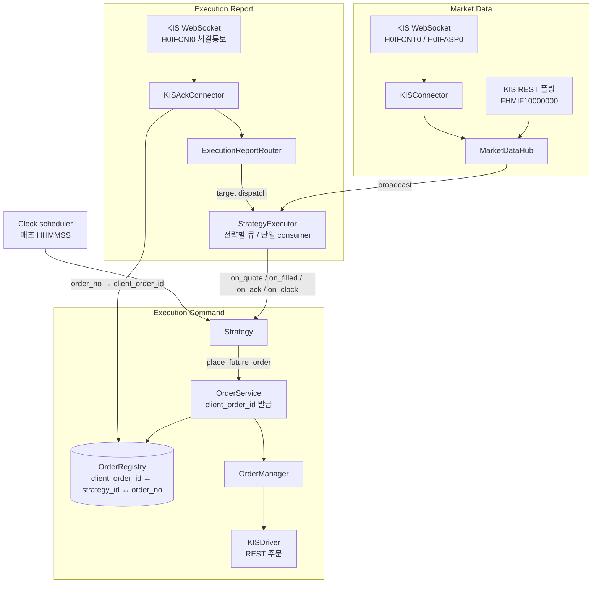

# System Trading

한국투자증권(KIS) Open API 위에서 동작하는 **이벤트 기반 선물 트레이딩 시스템**입니다.
KOSPI200 선물을 대상으로 시세 수신부터 전략 판단, 주문 송신, 체결 처리, 장마감 청산까지의 경로를 갖추고 있고,
모의투자 계좌에서 실제로 실행됩니다.

- 시세(Market Data)와 내 주문의 체결/응답(Execution Report)을 **물리적으로 분리된 경로**로 처리
- 전략은 브로커를 모름: 주문은 주입된 `OrderService`로만 내고, 브로커 라우팅은 설정이 결정
- 전략 콜백은 **전략별 단일 큐 + 단일 consumer**에서 순차 실행 (ACK 우선, 시세는 backpressure 시 최신값 유지)
- 장마감 전량 청산, 재시작 시 포지션 점검, 주문 거부 시 상태 미변경 등 **운영 안전장치** 내장

---

## 아키텍처



| 컴포넌트 | 위치 | 역할 |
| --- | --- | --- |
| `MarketDataHub` | `trading_system/market_data/` | 시세 이벤트(`FuturesSimpleQuote`/`FuturesSimpleFilled`)를 등록된 전략에 broadcast |
| `ExecutionReportRouter` | `trading_system/execution_report/` | 내 주문 ACK(`FuturesSimpleOrderAck`)만 받아 `strategy_id` → `client_order_id` 순으로 대상 전략을 찾고, 못 찾으면 drop (오배달 방지) |
| `StrategyExecutor` | `trading_system/strategy/execution/` | 모든 전략 콜백 실행의 단일 지점. 같은 전략의 이벤트는 순차 처리, ACK는 drop 금지 |
| `OrderService` / `OrderManager` | `trading_system/order/` | 전략에 주입되는 브로커 바인딩 주문 서비스 / 브로커별 Driver 레지스트리 |
| `OrderRegistry` | `trading_system/execution_report/` | `client_order_id ↔ strategy_id`, `order_no ↔ client_order_id` 매핑 (ACK 라우팅의 SSOT) |
| `KISAckConnector` | `trading_system/execution_report/connectors/` | 체결통보(H0IFCNI0, AES-256-CBC 암호화)를 복호화해 표준 ACK로 변환 |
| `StrategyManager` | `trading_system/strategy/` | 구성(composition) 레이어. 위 객체를 만들고 연결하며 전략 생성 시 의존성 주입 |

---

## 설계 원칙

### 1. 세 가지 이벤트를 코드 레벨에서 구분

실전 운영에서 가장 사고가 많이 나는 지점은 "시장 체결"과 "내 주문 체결"을 혼동하는 것입니다. 그래서 타입부터 분리했습니다.

| 개념 | 내부 타입 | 의미 | 전략 콜백 |
| --- | --- | --- | --- |
| Quote | `FuturesSimpleQuote` | 최우선 호가 (best bid/ask) | `on_quote()` |
| Market Tick | `FuturesSimpleFilled` | 시장 체결 / 현재가 (**내 주문 체결이 아님**) | `on_filled()` |
| Execution Report | `FuturesSimpleOrderAck` | **내 주문**의 상태 변화 (접수/거절/취소/체결) | `on_ack()` |

- 시장 틱은 트리거와 지표 계산에만 쓰고, 장부·포지션은 Execution Report(`ack_type=Filled`)로만 갱신하는 것이 원칙입니다.
- 경로도 물리적으로 분리돼 있습니다. `KISConnector`는 시세만 다루고 ACK 형태의 payload는 버리며, `ExecutionReportRouter`는 `FuturesSimpleOrderAck`가 아닌 타입이 들어오면 예외를 냅니다. 장부(`Book.process_ack()`)도 시장 틱은 반영하지 않고 건너뜁니다.
- `Cancel`(미체결 주문 취소)과 `Offset`(반대매매로 포지션 축소)은 다른 동작으로 다룹니다. 장마감 청산은 Offset이고, 취소는 `OrderService.cancel_future_order()` 경로입니다.

### 2. 책임 분리

| 역할 | 하는 일 | 예 |
| --- | --- | --- |
| **Connector** | 외부에서 들어오는 *이벤트*를 내부 타입으로 변환해 Hub/Router에 전달 | `KISConnector`, `KISAckConnector`, `NewBrokerConnector` |
| **Driver** | 내부의 *커맨드*를 외부 요청으로 변환해 전송 | `KISDriver`, `NewBrokerDriver` |
| **Hub / Router** | 이벤트 배포만 담당 (시세는 broadcast, ACK는 대상 전략에만) | `MarketDataHub`, `ExecutionReportRouter` |
| **OrderManager** | 브로커 키별 Driver 선택과 호출 | `OrderManager` |
| **Strategy** | 트리거·리스크·포지션 로직만. 외부 통신과 프로토콜은 모름 | `concepts/*` |

브로커가 바뀌어도 Connector와 Driver만 새로 만들면 되고, 전략 코드는 바뀌지 않습니다.

### 3. 전략 실행 모델

1. 전략 콜백은 모두 `async def`이고, **콜백을 호출하는 곳은 `StrategyExecutor` 하나뿐**입니다. Hub와 Router는 executor에 publish만 합니다.
2. 시스템은 **하나의 asyncio 이벤트 루프**를 소유합니다. 다른 스레드에서 오는 이벤트는 `publish_*_threadsafe()`(`loop.call_soon_threadsafe`)로만 루프에 들어옵니다.
3. 전략마다 큐를 두 개 둡니다.
   - `ack_queue`: 크기 제한 없음. **ACK는 절대 버리지 않는다**는 원칙을 구조로 강제합니다.
   - `md_queue`: 크기 제한 있음(기본 1000). 시세가 폭주하면 가장 오래된 것을 버리고 최신값을 유지합니다.
4. consumer는 ACK를 항상 먼저 처리합니다. 시세가 몰려도 내 주문의 정합성이 우선입니다.
5. 한 전략의 콜백 예외는 로그로 남기고 격리합니다. 다른 전략과 이후 이벤트 처리는 계속됩니다.

### 4. 설정 기반 브로커 라우팅

전략은 `broker` 인자를 갖지 않습니다. `StrategyManager.build_strategy()`가 설정을 보고 브로커가 바인딩된 `OrderService`를 주입합니다.

```yaml
# trading_system/config/config.yaml
execution:
  default_broker: kis          # kis | new_broker
  allow_kis_ack: true          # KIS 체결통보(H0IFCNI0) 구독 여부
  strategy_overrides: {}       # strategy_name -> broker
  symbol_overrides: {}         # symbol -> broker
```

우선순위: `symbol_overrides` → `strategy_overrides` → `default_broker`

### 토큰 분리 (PROD / VPS)

KIS의 실시간 지수선물 시세 TR_ID(H0IFCNT0/H0IFASP0)는 **실전계좌 전용**이고, 주문·잔고·체결통보는 모의투자 계좌 기준입니다.
그래서 시세용 토큰(PROD)과 주문용 토큰(VPS)을 분리해 관리합니다. PROD 키가 없으면 REST 폴링만으로 동작합니다.

---

## 샘플 전략

`trading_system/strategy/concepts/`

| 실행 이름 | 클래스 | 로직 |
| --- | --- | --- |
| `minute_breakout` | `MinuteHighBreakoutStrategy` | 최근 N개 완결 1분봉 최고가를 상향 돌파하면 매수, 진입가 대비 손절/익절 후 재진입 |
| `vol_breakout_long` / `vol_breakout_short` | `VolBreakingLong` / `VolBreakingShort` | 기준가 ± k × 전일 고저폭 돌파 시 진입 (체크 시각 분할), 청산 구간 분할 청산, 분봉 종가 기준 손절 |
| `channel_breakout` | `CBSplitLongOnlyPct` | 장 초반(~09:30) 고가 채널 상향 돌파 시 분할 매수, 채널 대비 하락 시 분할 손절 |
| (항상 등록) | `KrxExitAll` | 15:00 이후 계좌의 모든 선물 포지션을 시장가로 청산하는 안전장치 |

---

## 실행

**요구사항:** Python 3.9 ~ 3.11 (pandas 1.x 호환), KIS Open API 모의투자 선물옵션 계좌

```bash
conda create -n trading python=3.11 -y && conda activate trading
pip install -r requirements-dev.txt
cp .env.example .env    # 모의투자 앱 키/시크릿, 계좌번호(12345678-03) 입력
```

```bash
python main.py                                    # N분 고가 돌파, dry-run (주문을 내지 않고 신호만 로깅)
python main.py --strategy vol_breakout_long
python main.py --strategy channel_breakout --send-orders   # 모의투자 계좌로 실제 주문
python main.py -v                                 # 모든 모듈 INFO 로그
```

- 기본은 **dry-run**입니다. `--send-orders`를 줄 때만 주문이 나가며, 이때 장마감 청산(`KrxExitAll`)도 실제로 주문을 냅니다.
- 종목코드는 `trading_system/config/config.yaml`의 `market_data.kis.subscriptions`에 있습니다. KOSPI200 선물은 분기마다 만기가 돌아오므로 롤오버 때 갱신해야 합니다(현재 `A01612`, 2026년 12월물).

```bash
pytest
```

---

## 운영 안전장치와 설계 결정

실제 모의투자 서버에 붙여 보면서 발견하고 반영한 것들입니다.

| 문제 | 대응 |
| --- | --- |
| KIS 초당 요청 제한(`EGW00201`)에 자주 걸림 | 시세 5초 / NAV 60초 폴링, 실패해도 루프를 죽이지 않고 다음 주기 재시도. 연속 호출이 필요한 조회 사이에 간격을 둠 |
| 잔고조회가 성공 코드(`rt_cd=0`)이면서 보유 포지션만 비어 오는 경우가 있음 | 시작 시와 장마감 청산 시 청산가능수량 조회(VTTO5105R)로 교차검증. 두 API가 상충하거나 확인이 안 되면 추측성 주문 없이 전략을 **halted** |
| 보유 포지션 판단 필드 | `tot_psbl_qty`(신규 주문 가능 포함)는 플랫 계좌에서도 0보다 크므로, 반드시 `lqd_psbl_qty1`(청산가능수량)로 판단 |
| 주문 거부를 체결로 착각 | 브로커가 접수(`rt_cd == '0'`)한 경우에만 전략 포지션 상태를 변경 |
| 브로커 체결통보는 우리가 만든 `client_order_id`를 돌려주지 않음 | 주문 응답의 `ODNO`를 `OrderRegistry`에 등록해 두고 체결통보의 주문번호로 원 주문/전략을 역참조 |
| 장마감 청산이 진입 제한 카운터(`bullet`)에 막힘 | 청산·손절은 리스크를 줄이는 동작이므로 `bullet`과 무관하게 항상 실행 |
| ACK와 시세가 같은 틱에 도착하면 하나가 유실 | `StrategyExecutor`가 완료된 이벤트를 모두 처리하도록 수정 (ACK 우선) |
| 재시작 시 기존 포지션의 손절/익절 라인 소실 | 시작 시 잔고의 평균체결단가로 전략 상태를 복원 |

---

## 외부 주문 프로그램(DMA) 연동 인터페이스

KIS 외에 별도 주문 프로그램(DMA)으로 주문을 내는 구성을 위해, 주문 커맨드와 실행 리포트의 경로와 메시지 계약을 미리 정해 두었습니다.

```
OMS -> DMA  (주문 커맨드)   : OrderService -> OrderManager -> NewBrokerDriver
DMA -> OMS  (실행 리포트)   : DMA 이벤트(dict) -> NewBrokerConnector -> ExecutionReportRouter -> 전략.on_ack
```

**OrderCommand (OMS → DMA)**

| 필드 | 필수 | 설명 |
| --- | --- | --- |
| `client_order_id` | ✓ | OMS가 발급하는 idempotency key. 같은 주문 의도의 재전송이 중복 실행되지 않게 함 |
| `symbol`, `side`, `qty`, `price`, `price_type`, `time_in_force` | ✓ | 주문 내용 (`BUY`/`SELL`, `LIMIT`/`MARKET`) |
| `account_id`, `strategy_id`, `timestamp` | 권장 | 계좌 식별, 추적용 |

**ExecutionReport (DMA → OMS)**: 가격·수량만으로는 운영 정합성을 지킬 수 없어서 아래를 최소 세트로 둡니다.

| 필드 | 필수 | 설명 |
| --- | --- | --- |
| `event_id` | ✓ | 이벤트 고유 키. at-least-once 전송에서 중복은 정상이므로 1회만 반영 |
| `seq` | ✓ | 증가하는 시퀀스. 역순·유실 감지 |
| `client_order_id`, `order_id` | ✓ | OMS 주문 의도 ↔ 브로커 주문번호 |
| `status` | ✓ | `RECEIVED` / `REJECTED` / `PARTIAL_FILL` / `FILL` / `CANCELED` |
| `last_fill_qty`, `last_fill_price` | ✓ | 이번 이벤트에서 새로 체결된 양과 가격 |
| `cum_fill_qty`, `remaining_qty`, `reject_reason`, `strategy_id`, `broker` | 권장 | 부분체결·거절 분석, 라우팅 |

`NewBrokerConnector`는 `event_id`가 중복되면 버리고, 같은 (브로커, 계좌)의 `seq`가 역순이면 버립니다(`strict_seq=True`).
DMA가 아직 없어도 시나리오를 재현할 수 있게 드라이런 주입을 제공합니다.

```python
stg_manager.ingest_execution_reports([{
    "type": "ExecutionReport", "event_id": "evt-1", "seq": 1,
    "client_order_id": "MinHighBO-20261102-...", "order_id": "BRK-1",
    "symbol": "A01612", "status": "FILL", "side": "BUY",
    "last_fill_qty": 1, "last_fill_price": 899.45,
    "strategy_id": "MinHighBO", "broker": "new_broker", "account": "12345678-03",
}])
```

`NewBrokerDriver`는 인터페이스와 반환 형태만 고정한 뼈대(dummy 모드)이고, 실제 전송(HTTP/TCP/MQ)은 구현돼 있지 않습니다.

---

## 운영 체크리스트

| 항목 | 상태 | 내용 |
| --- | --- | --- |
| 중복 주문 방지 | 구현 | 주문마다 `client_order_id` 발급, `OrderRegistry`에 등록 |
| 주문번호 매핑 | 구현 | `client_order_id ↔ strategy_id ↔ order_no`를 `OrderRegistry` 한 곳에서 관리 |
| 중복 / 역순 이벤트 | 구현 | `event_id` 중복 제거(KIS·DMA 커넥터), `seq` 역순 차단(DMA 커넥터) |
| 시작 시 포지션 스냅샷 | 구현 | 잔고조회 + 청산가능수량 교차검증, 불확실하면 전략 정지 |
| 장마감 청산 | 구현 | `KrxExitAll`, 재시도 창과 교차검증 포함 |
| 주문 취소 | 부분 | 단건 취소(`cancel_future_order`) 경로만 있음. `cancel_all`, 미체결 조회 기반 정리는 미구현 |
| 부분체결 | 부분 | 장부(`Book`)는 체결 내역을 누적하지만, 샘플 전략은 접수 기준으로 포지션을 잡음 |
| Kill Switch | 미구현 | 신규 주문 차단 + 미체결 일괄 취소(+ 선택적 전량 청산)를 하나의 동작으로 정의할 계획 |
| 재연결 후 누락 복구 | 미구현 | `last_seq` 체크포인트 저장 후 재연결 시 이어받기(replay) |
| 재시작 복구 순서 | 미구현 | 매핑·체크포인트 로드 → ACK 경로 시작 → 시세 경로 시작 → 전략 활성화 순서로 정리 예정 |

### 알려진 한계

- **체결통보(H0IFCNI0) 경로는 실서버로 충분히 검증되지 않았습니다.** 필드 인덱스는 문서 기반 매핑이며, 현재 샘플 전략들은 체결통보 없이도 동작하도록 "접수 성공 = 체결" 가정을 씁니다.
- 체결통보 WebSocket 재연결 후 누락분 보정(`KISAckConnector.reconcile_via_rest`)은 수동 호출용 스캐폴딩입니다.
- `OrderRegistry`는 메모리 기반이라 재시작 시 매핑이 초기화됩니다(재시작 복구는 잔고 조회로 대신함).
- 시각 비교는 OS 로컬 시간 기준입니다. KST가 아닌 서버에서 돌리려면 타임존을 고정해야 합니다.

---

## 디렉터리

```
main.py                        # 실행 진입점 (전략 선택, 폴링 루프, clock scheduler, 시작 점검)
trading_system/
  api/kis/                     # KIS REST 클라이언트, WebSocket 스트리머, 토큰 관리
  config/                      # config.yaml(TR_ID 엔드포인트, 라우팅, 구독 종목) + .env 로더
  market_data/                 # MarketDataHub, KISConnector, 전일 OHLC 로더
  execution_report/            # ExecutionReportRouter, OrderRegistry, 체결통보 커넥터
  order/                       # OrderService, OrderManager, 브로커 Driver, 라우팅 규칙
  strategy/                    # StrategyManager, StrategyExecutor, 샘플 전략
  book/                        # 주문 장부 (ACK 기록)
  types/                       # 공통 Enum / 이벤트 타입
tests/                         # Executor 순서/backpressure, 전략 로직, 안전장치 회귀 테스트
```
